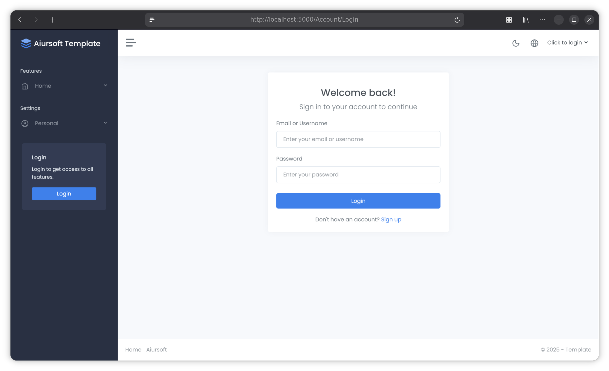

# Step 1 - Create and Run Your Project



**Our goal:** see the unmodified application running and sign in once.
We will write our own feature in the next chapter.

## 1.1 Get the tools ready

The main path in this tutorial uses Bash on Linux, such as AnduinOS.
Windows and macOS also work, but their installation instructions differ.

Install these tools before continuing:

- **Git:** records changes to your source code. Use your operating system's software installer.
- **.NET 10 SDK:** compiles and runs C#. Follow the [.NET installation instructions](https://learn.microsoft.com/en-us/dotnet/core/install/linux-ubuntu-install) for your distribution.
- **Node.js 24 and npm:** install the browser-side libraries. Follow the [Node.js installation instructions](https://nodejs.org/en/download).
- **Docker Engine:** runs the example database and deployment container. Follow the [Docker installation instructions](https://docs.docker.com/engine/install/ubuntu/).
- **An editor:** [Visual Studio Code](https://code.visualstudio.com/docs/setup/linux) or Rider is fine.

Use the guide for your actual operating-system version.
Do not copy an Ubuntu release's package setup into a different release.

Now open a terminal. Let's check each tool separately.

```bash
git --version
```

This asks Git to print its version. **Expected:** a line beginning with `git version`.

```bash
dotnet --list-sdks
```

This lists the installed .NET SDKs. **Expected:** at least one `10.0.x` entry.
A runtime alone is not enough to compile the project.

```bash
node --version
```

This checks Node.js. **Expected:** `v24.x`.

```bash
npm --version
```

This checks Node's package manager. **Expected:** a version number.

```bash
docker --version
```

This checks the Docker command. **Expected:** a Docker version.
We will check that the Docker service works when we use it in Step 4.

```bash
docker buildx version
```

This checks the standard Buildx/BuildKit build component used by the template's Dockerfile.
**Expected:** a Buildx version, not `unknown command`.
If it is missing, finish the Buildx plugin installation from the Docker installation guide above.
A Docker client version alone does not check that component.

If a command says `command not found`, finish installing that tool first.
You have not broken the project; we have not created it yet.

## 1.2 Install the two .NET tools

First, install the database migration tool:

```bash
dotnet tool install --global dotnet-ef --version '10.*'
```

`--global` installs the command for your user account.
`--version '10.*'` chooses an EF tool compatible with our .NET 10 application.

**Expected:** a message saying `dotnet-ef` was successfully installed.

If it says the tool is already installed, check its version after the PATH step below.
Use `dotnet tool update --global dotnet-ef --version '10.*'` only if it needs updating.

Next, install the project generator:

```bash
dotnet tool install --global Aiursoft.Voyager
```

Voyager creates the starting application for us.
**Expected:** a successful installation message.
An already-installed message is also fine.

Make the installed tools available in this terminal:

```bash
export PATH="$PATH:$HOME/.dotnet/tools"
```

`PATH` is the list of folders the terminal searches for commands.
This adds the folder containing Voyager and the EF tool.
It applies to this terminal; repeat it if a new terminal cannot find the tools.

```bash
dotnet ef --version
```

This checks the EF tool. **Expected:** version `10.x`.

```bash
voyager --version
```

This checks Voyager. **Expected:** its version number.

Voyager also creates a Git commit.
If you have never configured Git, set your own name and email first.
Replace both example values before running these commands:

```bash
git config --global user.name "Your Name"
```

This is the author name Git will record on your commits.

```bash
git config --global user.email "you@example.com"
```

This is the author's email address. Use your own address.

## 1.3 Create the empty folder

Let's put the project somewhere easy to find.

```bash
mkdir -p ~/Source
```

This creates a `Source` folder in your home directory if it does not exist.
`-p` also makes it safe when that parent folder already exists.

```bash
cd ~/Source
```

This moves the terminal into that folder.

```bash
mkdir MyOrg.MarkToHtml
```

This creates our new project's empty folder.
If it already exists, stop and choose a different parent folder; do not delete existing work.

```bash
cd MyOrg.MarkToHtml
```

This moves into the new folder.
Voyager uses this folder's name as the application name.

```bash
pwd
```

This prints your current folder.
**Expected:** a path ending in `/Source/MyOrg.MarkToHtml`.

## 1.4 Let Voyager create the application

```bash
voyager new -t web-app-all-in-one
```

`new` creates a project. `-t` selects the `web-app-all-in-one` template.
Wait for the downloads and generation to finish.

```bash
ls
```

This lists the generated files.
**Expected:** `MyOrg.MarkToHtml.sln`, `src`, `tests`, `Dockerfile`, and other project files.

A few landmarks are enough for now:

- `MyOrg.MarkToHtml.sln` groups the projects into one solution.
- `src/MyOrg.MarkToHtml` is the web application. Most of our edits go here.
- `src/MyOrg.MarkToHtml.Entities` contains database models.
- The `.Sqlite` and `.MySql` projects contain provider-specific migrations.
- `tests` contains the template's existing tests.
- `Dockerfile` packages the application later.
- `.git` stores Git history; `.gitignore` keeps build output out of commits.
- `ninja.yaml`, `nuget.config`, and `.gitlab-ci.yml` support the existing project workflow.

Keep these generated files. We do not need to remove anything to follow the tutorial.

Open this folder in your editor.
Keep the terminal in the repository root.

## 1.5 Download the browser libraries

```bash
cd src/MyOrg.MarkToHtml/wwwroot
```

This moves to the web application's static-file folder.
Its `package.json` lists the browser libraries.

```bash
npm install
```

This downloads those libraries into `node_modules`.
**Expected:** npm finishes without an error. Downloads may take a minute.

```bash
cd ../../..
```

Each `..` moves up one folder.
Three of them take us from `wwwroot` back to the repository root.

```bash
pwd
```

**Expected:** the path ends in `/Source/MyOrg.MarkToHtml` again.
If it ends in `wwwroot`, fix the folder before continuing.

## 1.6 Give this experiment its own file storage

```bash
export Storage__Path="$PWD/.tutorial-data"
```

This tells the app to store uploaded files in this project's own folder.
`$PWD` means the current folder. The double underscore represents a configuration section.

We will explain environment variables in Step 7.
For now, keep using this terminal so this setting stays available.

In the repository root's `.gitignore`, add this line and save the file:

```gitignore
.tutorial-data/
.tutorial-test-data/
```

These entries keep experimental uploads and later test files out of Git.

Also append these entries to the existing `.dockerignore` in the repository root:

```dockerignore
.tutorial-data/
.tutorial-test-data/
**/app.db
**/app.db-*
```

Keep its other rules. These additions keep local uploads, test files, and SQLite database/journal files out of Docker's build context.
Git's ignore file and Docker's ignore file do different jobs; updating one does not update the other.
Do not delete a shared `/tmp/data` folder to reset this app.

## 1.7 Build and run

```bash
dotnet build ./MyOrg.MarkToHtml.sln
```

This compiles the projects in the solution.
**Expected:** `Build succeeded.` and `0 Error(s)`.
If the build fails, read the first error before moving on.

```bash
dotnet run --project ./src/MyOrg.MarkToHtml/MyOrg.MarkToHtml.csproj
```

This starts the web application.
`--project` identifies its C# project explicitly.
The neighbouring `.aosproj` file is a packaging project; it is not the project we want to run.

**Expected:** a listening address, normally `http://localhost:5000`.
Leave this terminal running while you open that address in your browser.

Sign in with the development account:

- Username: `admin`
- Password: `Admin@123456!`

These are development credentials. We will change the password before publishing in Step 12.

## Checkpoint 1 - Your starting application works

Before continuing, check all four items:

- The build has no errors.
- The browser opens the app at the printed address.
- The development administrator can sign in.
- `src/MyOrg.MarkToHtml/app.db` now exists: the app created its SQLite database.

No MySQL setup is needed yet. SQLite is the default.
Uploaded files live in the isolated folder we configured above.

Press **Ctrl+C** in the server terminal and wait for the prompt.
Nice work. You now have a working starting point.

Continue with [Step 2](./step2.md).
