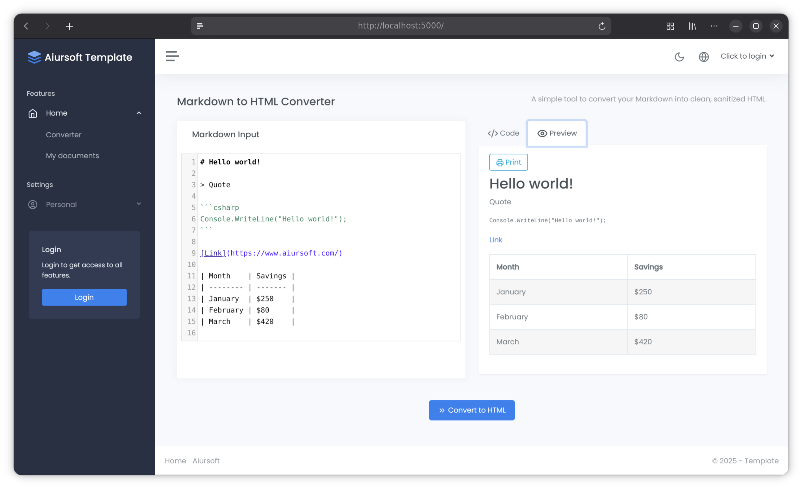

# Aiursoft Template Tutorial - Step 3 - Add a New Page



In the previous step, we successfully added the functionality to convert markdown to HTML. Next, we need to create a frontend page that allows users to input markdown and preview the generated HTML.


**Before you edit:** stop the server with **Ctrl+C**.

```bash
cd ~/Source/MyOrg.MarkToHtml
```

This returns to the repository root. All `src/` paths below start here.

**Our goal:** convert Markdown on a real page, with an editor and a safe preview.

## Step 3.1 Modify to Add Necessary Services to the Dependency Injection Container

ASP.NET Core uses dependency injection to manage application services. To make Markdig and HtmlSanitizer available in the application, we need to add them to the dependency injection container.

First, modify the `./src/MyOrg.MarkToHtml/Startup.cs` file, and add the necessary using statements:

```csharp
using Ganss.Xss;
using Markdig;
```

Find `ConfigureServices` in Startup.cs. Inside its braces, insert the following statements immediately before the existing `// AppSettings.` comment. Keep the existing registrations below them:

```csharp
// Add the markdown pipeline and HTML sanitizer
var pipeline = new MarkdownPipelineBuilder().UseAdvancedExtensions().Build();
services.AddSingleton(pipeline);
services.AddSingleton<HtmlSanitizer>();
```

## Step 3.2 Write a brand new conversion service

To better organize the code, we will create a new service class specifically responsible for converting markdown to HTML. This will make the code more modular and easier to maintain.

All service classes should be placed under the `./src/MyOrg.MarkToHtml/Services/` directory.

Create a new file named `MarkToHtmlService.cs` here and add the following code:

```csharp title="MarkToHtmlService.cs"
using Aiursoft.Scanner.Abstractions;
using Ganss.Xss;
using Markdig;

namespace MyOrg.MarkToHtml.Services;

public class MarkToHtmlService(MarkdownPipeline pipeline, HtmlSanitizer sanitizer) : ITransientDependency
{
    public string ConvertMarkdownToHtml(string markdown)
    {
        // Use the pre-built, singleton instances. No more 'new' keywords!
        var html = Markdown.ToHtml(markdown, pipeline);
        var outputHtml = sanitizer.Sanitize(html);
        return outputHtml;
    }
}
```

Note that here we implement the interface: `ITransientDependency` for the service.

This indicates that the service is transient, and a new instance is created each time the service container resolves it.

Aiursoft Scanner will automatically register classes implementing this interface into the dependency injection container, without needing to modify the `Startup.cs` file.

Similarly, we request instances of `MarkdownPipeline` and `HtmlSanitizer` in the constructor. Since we have already registered them as singletons in the `Startup.cs` file, the same instance will be automatically injected here.

### A short pause: what do the lifetimes mean?

**Singleton:** the application shares one instance. Shared mutable state must be thread-safe.

**Scoped:** one instance per request in a normal ASP.NET Core web application.

**Transient:** a new instance each time the container resolves the service, even within the same request.

A scoped service may depend on a transient service.
Do not inject a scoped database context directly into a singleton; that captures request-scoped state for too long.

These are the [.NET service-lifetime rules](https://learn.microsoft.com/en-us/dotnet/core/extensions/dependency-injection/service-lifetimes).
You do not need to memorize them all right now.

We build the Markdown pipeline once and share it.

We also share the sanitizer, and do not change its configuration while requests run.

The [sanitizer's thread-safety guidance](https://github.com/mganss/HtmlSanitizer#thread-safety) explains that restriction.

Our conversion service is transient. The template discovers its `ITransientDependency` marker automatically.

## Step 3.3 Modify ViewModel

To enable interaction between the frontend page and the backend service, we need a ViewModel. A ViewModel is a design pattern used to pass data from the controller to the view.

Here, for simplicity, we directly modify the `./src/MyOrg.MarkToHtml/Models/HomeViewModels/IndexViewModel.cs` file, adding a new property `InputMarkdown` to store the user's input markdown content, and use the `OutputHtml` property to store the generated HTML content.

```csharp title="IndexViewModel.cs"
using System.ComponentModel.DataAnnotations;
using Aiursoft.UiStack.Layout;

namespace MyOrg.MarkToHtml.Models.HomeViewModels;

public class IndexViewModel : UiStackLayoutViewModel
{
    public IndexViewModel()
    {
        PageTitle = "Markdown to HTML Converter";
    }

    [Required(ErrorMessage = "Please input your markdown content!")]
    public string InputMarkdown { get; set; } = """
                                                # Hello world!

                                                > Quote

                                                [Link](https://www.aiursoft.com/)

                                                | Month    | Savings |
                                                | -------- | ------- |
                                                | January  | $250    |
                                                | February | $80     |
                                                | March    | $420    |

                                                """;

    public string OutputHtml { get; set; } = string.Empty;
}
```

Note that the `[Required]` attribute here indicates that the `InputMarkdown` property is required.

If the user enters no content, an error message will be displayed when the form is submitted.

If the user forces submission via HTTP Post, the server-side `ModelState.IsValid` will return false.

## Step 3.4 Modify Controller

Controller, also known as the controller, is the C in the MVC pattern, responsible for handling user requests and returning responses.

In our structure, the Controller will not directly render views, but instead pass data to the view model (ViewModel), which will then render the page.

We need to modify the `./src/MyOrg.MarkToHtml/Controllers/HomeController.cs` file, adding dependency injection for `MarkToHtmlService`, and using this service in the `Index` method to convert the user's input markdown into HTML.

Modify its constructor, adding a parameter for `MarkToHtmlService`:

```csharp
public class HomeController(
    MarkToHtmlService mtohService) : Controller
```

Next, modify the `[RenderInNavBar]` attribute of the `GET` method in the `Index` method, ensuring its name has been updated to "Convert Document":

```csharp
[RenderInNavBar(
NavGroupName = "Features",
NavGroupOrder = 1,
CascadedLinksGroupName = "Home",
CascadedLinksIcon = "home",
CascadedLinksOrder = 1,
LinkText = "Convert Document",
LinkOrder = 1)]
```

Then **add** a new `Index` method to handle POST requests, converting the input markdown to HTML:

```csharp
[HttpPost]
[ValidateAntiForgeryToken]
public IActionResult Index(IndexViewModel model)
{
    // If the model state is invalid, return the view with the current model to show validation errors
    if (!ModelState.IsValid)
    {
        return this.StackView(model);
    }

    // Convert the input markdown to HTML using the MarkToHtmlService
    model.OutputHtml = mtohService.ConvertMarkdownToHtml(model.InputMarkdown);
    return this.StackView(model);
}
```

!!! tip "Aiursoft Template-specific view return method"

    Aiursoft Template requires that all view returns use the `this.StackView(model)` method instead of directly using `return View(model)`. This is because the `StackView` method automatically handles certain Aiursoft UiStack-related logic, such as navigation bars and layouts.

    Here, the `[HttpPost]` attribute indicates that this method only handles POST requests, and the `[ValidateAntiForgeryToken]` attribute is used to prevent cross-site request forgery (CSRF) attacks. ASP.NET Core forms automatically include a anti-forgery token when submitted, and the server-side validates this token to ensure the request's legitimacy.

    At this point, our `HomeController.cs` file should look something like this:

```csharp
using MyOrg.MarkToHtml.Models.HomeViewModels;
using MyOrg.MarkToHtml.Services;
using Aiursoft.UiStack.Navigation;
using Microsoft.AspNetCore.Mvc;

namespace MyOrg.MarkToHtml.Controllers;

public class HomeController(
    MarkToHtmlService mtohService) : Controller
{
    [RenderInNavBar(
        NavGroupName = "Features",
        NavGroupOrder = 1,
        CascadedLinksGroupName = "Home",
        CascadedLinksIcon = "home",
        CascadedLinksOrder = 1,
        LinkText = "Convert Document",
        LinkOrder = 1)]
    public IActionResult Index()
    {
        return this.StackView(new IndexViewModel());
    }

    [HttpPost]
    [ValidateAntiForgeryToken]
    public IActionResult Index(IndexViewModel model)
    {
        if (!ModelState.IsValid)
        {
            return this.StackView(model);
        }

        model.OutputHtml = mtohService.ConvertMarkdownToHtml(model.InputMarkdown);
        return this.StackView(model);
    }
}
```

!!! tip "[RenderInNavBar] Advanced Tips"

    The `[RenderInNavBar]` attribute has many parameters that help you organize the navigation bar more effectively.

    It has three levels. The first level is always expanded, a group of multiple tabs, called `NavGroup`.

    The second level is collapsible, a group of multiple tabs, called `CascadedLinksGroup`. It is the only level that has an icon. It appears as a collapsible menu. Users can expand or collapse it by clicking the icon or the name.

    The third level is the actual links, called `Link`.

    The `Order` parameter is used to control the sorting order within the same level. The smaller the number, the earlier it appears. For example, we placed `Roles` inside the `Directory` group under the `Administration` group and set its order to `2`, so it appears after `Users`.

    ```csharp
    // Users management
    [RenderInNavBar(
    NavGroupName = "Administration",
    NavGroupOrder = 9999,
    CascadedLinksGroupName = "Directory",
    CascadedLinksIcon = "users",
    CascadedLinksOrder = 9998,
    LinkText = "Users",
    LinkOrder = 1)]

    // Roles management
    [RenderInNavBar(
    NavGroupName = "Administration",
    NavGroupOrder = 9999,
    CascadedLinksGroupName = "Directory",
    CascadedLinksIcon = "users",
    CascadedLinksOrder = 9998,
    LinkText = "Roles",
    LinkOrder = 2)]
    ```

## Step 3.5 Modify the View

The View is the V in the MVC pattern, responsible for rendering the user interface. In our structure, the View uses Razor syntax to generate HTML pages.

!!! note "The View uses Razor syntax"

    Razor is a template engine based on C#, allowing you to embed C# code within HTML. Its file extensions are typically `.cshtml`. Razor syntax is highly flexible, enabling you to easily render server-side data to client-side pages.

    It is strongly recommended to review the basics of [Razor syntax](https://learn.microsoft.com/en-us/aspnet/core/mvc/views/razor) before proceeding.

Clearly, the responsibility of the View is to render a visually appealing page, allowing users to input markdown and preview the generated HTML.

When writing the View, you only need to respect the properties of the ViewModel.

The View file is located at `./src/MyOrg.MarkToHtml/Views/Home/Index.cshtml`.

By default, it may contain some sample content.

Feel free to delete it entirely and make your modifications.

```html title="Index.cshtml"
@using MyOrg.MarkToHtml.Controllers
@model MyOrg.MarkToHtml.Models.HomeViewModels.IndexViewModel

<div class="row mb-2 mb-xl-3">
    <div class="col-auto d-none d-sm-block">
        <h3>@Localizer["Markdown to HTML Converter"]</h3>
    </div>
    <div class="col-auto ms-auto text-end mt-n1">
        <p class="mb-0 text-muted">@Localizer["A simple tool to convert your Markdown into clean, sanitized HTML."]</p>
    </div>
</div>

<form asp-action="Index" method="post" id="markdown-form">
    <div class="row">
        @* Left Column: Markdown Input *@
        <div class="col-lg-6 d-flex">
            <div class="card flex-fill">
                <div class="card-header">
                    <h5 class="card-title mb-0">
                        <i class="align-middle" data-lucide="markdown">&nbsp;</i>
                        @Localizer["Markdown Input"]
                    </h5>
                </div>
                <div class="card-body p-2">
                    <textarea asp-for="InputMarkdown" class="form-control" id="markdown-editor"
                              placeholder="@Localizer["Type your Markdown here..."]"></textarea>
                    <span asp-validation-for="InputMarkdown" class="text-danger"></span>
                </div>
            </div>
        </div>

        @* Right Column: Standalone Tab Component *@
        <div class="col-lg-6 d-flex flex-column">
            @* The tab component now stands alone and fills the available space *@
            <div class="tab flex-grow-1">
                <ul class="nav nav-tabs" role="tablist">
                    <li class="nav-item" role="presentation">
                        @* The 'active' class is now on the link (<a>), not the list item (<li>) *@
                        <a class="nav-link active" href="#code" data-bs-toggle="tab" role="tab" aria-selected="true">
                            <i class="align-middle" data-lucide="code-2">&nbsp;</i>
                            @Localizer["Code"]
                        </a>
                    </li>
                    <li class="nav-item" role="presentation">
                        <a class="nav-link" href="#preview" data-bs-toggle="tab" role="tab" aria-selected="false">
                            <i class="align-middle" data-lucide="eye">&nbsp;</i>
                            @Localizer["Preview"]
                        </a>
                    </li>
                </ul>
                <div class="tab-content pt-3">
                    @* Code Pane *@
                    <div class="tab-pane active show" id="code" role="tabpanel">
                        <button type="button" id="copy-button" class="btn btn-outline-primary mb-2" title="@Localizer["Copy HTML to clipboard"]">
                            <i class="align-middle" data-lucide="copy"></i> @Localizer["Copy"]
                        </button>
                        <textarea class="form-control" rows="25" id="html-output" readonly>@Model.OutputHtml</textarea>
                    </div>
                    @* Preview Pane *@
                    <div class="tab-pane" id="preview" role="tabpanel">
                        @if (!string.IsNullOrEmpty(Model.OutputHtml))
                        {
                            <button type="button" id="print-button" class="btn btn-outline-info mb-2" title="@Localizer["Print Preview"]">
                                <i class="align-middle" data-lucide="printer"></i> @Localizer["Print"]
                            </button>

                            <div id="printable-area">
                                @Html.Raw(Model.OutputHtml)
                            </div>
                        }
                        else
                        {
                            <div class="text-center p-5">
                                <p class="text-muted">@Localizer["HTML preview will appear here after conversion."]</p>
                            </div>
                        }
                    </div>
                </div>
            </div>
        </div>
    </div>

    @* Submit Button Row *@
    <div class="row mt-3">
        <div class="col text-center">
            <button type="submit" class="btn btn-primary btn-lg">
                <i class="align-middle" data-lucide="chevrons-right">&nbsp;</i>
                @Localizer["Convert to HTML"]
            </button>
        </div>
    </div>
</form>
```

In the above example, we've used numerous Razor techniques to dynamically generate HTML pages.

For instance: `@* Something *@` is used to add comments; `@model` specifies the ViewModel type used by the view, allowing access to the ViewModel via `@Model.Something`; `@inject` is used to inject services; `@Localizer["Some Text"]` is used for localizing strings; and `@Html.Raw(Model.OutputHtml)` is used to render unencoded HTML content.

!!! example "C# Code Blocks in Razor Syntax - Server-Side Rendering"

    Razor can use C# statements such as `@if` and `@foreach` to choose which HTML to send.

    That C# runs on the server. The browser receives the resulting HTML, not the C# source.

    This is server-side rendering. Browser interactions still belong in separate JavaScript files.

In the following examples, we'll extensively use this technique to render pages.

## Step 3.6 Add Necessary Styles and Scripts

Clearly, the above view can only handle basic editing and preview functionality. Features like the copy button, print button, and code highlighting require additional styles and scripts.

First, recall when we installed `codemirror`? Now we need to import it into the page.

At the end of the view file above, add the following code:

```html
@{
    var isDarkMode = Context.Request.Cookies[ThemeController.ThemeCookieKey] == true.ToString();
    var theme = isDarkMode ? "material" : "eclipse";
}

@* ReSharper disable once Razor.SectionNotResolved *@
@section styles {
    <link rel="stylesheet" href="~/node_modules/codemirror/lib/codemirror.css"/>
    <link rel="stylesheet" href="~/node_modules/codemirror/theme/@(theme).css" />
    <style>
        .CodeMirror, #preview {
            max-height: 70vh;
        }
        #preview {
            overflow-y: auto;
        }
        .CodeMirror {
            border: 1px solid #dee2e6;
            height: auto;
            display: flex;
            flex-direction: column;
        }
        .CodeMirror-scroll {
            flex-grow: 1;
            overflow: auto !important;
            position: relative;
        }

        @@media print {
            @@page {
                margin-top: 2cm;
                margin-bottom: 2cm;
            }

            body * {
                visibility: hidden;
            }

            #printable-area, #printable-area * {
                visibility: visible;
            }

            #printable-area {
                position: absolute;
                left: 0;
                top: 0;
                width: 100%;
                padding: 1.2cm;
            }

            #printable-area pre,
            #printable-area code {
                white-space: pre-wrap !important;
                overflow-wrap: break-word;
                word-wrap: break-word;
                color: #222 !important;
            }

            #printable-area {
                font-family: Georgia, "Times New Roman", serif;
                font-size: 12pt;
                line-height: 1.5;
                color: #000 !important;
            }

            #printable-area strong, #printable-area b {
                font-weight: 700 !important; /* Use a heavy font-weight */
                color: inherit !important;
            }

            #printable-area h1, #printable-area h2, #printable-area h3 {
                margin-top: 24pt;
                margin-bottom: 12pt;
            }

            #printable-area a[href]::after {
                content: " (" attr(href) ")";
                font-size: 9pt;
                color: #555;
            }

            #printable-area table {
                width: 100%;
                border-collapse: collapse;
                margin-top: 1rem;
                font-size: 11pt;
            }
            #printable-area th, #printable-area td {
                border: 1px solid #ccc;
                padding: 0.5rem;
                text-align: left;
            }
        }
    </style>
}
```

Thus, we have introduced the CodeMirror styles and added some custom styles to enhance the page's appearance.

!!! note "Aiursoft Template-specific style insertion method"

    The `@section styles` above is a pre-defined section in the template file used to insert page-specific styles. You can add any required CSS styles here. It will be rendered within the `<head>` tag of the page. In addition to inline styles, you can also use `<link>` tags to include external style sheets.

!!! warning "Be sure to use ReSharper disable once Razor.SectionNotResolved to avoid Razor errors"

    Since Aiursoft Template uses a custom view engine, ReSharper or Rider might not correctly recognize `@section styles`, leading to errors. To avoid this issue, we can use `@* ReSharper disable once Razor.SectionNotResolved *@` to instruct ReSharper to ignore this error.

Note: Code enclosed in `@{ }` is a C# code block, which executes on the server side.

The `@@` symbol is used to escape the `@` sign so it can be used within CSS.

Here, we obtain a server-side variable `theme`, which dynamically sets the CodeMirror theme based on the user's theme preference.

To ensure the editor control and preview area do not become too tall, we set their maximum height to 70vh (70% of the viewport height). This ensures they display well on most screens.

For easier printing, we have applied numerous CSS techniques to ensure the printed content is visually appealing and readable. We also used the `#printable-area` ID to specify the print area.

Clearly, we still need some JavaScript code to initialize the CodeMirror editor and handle the functionality of the copy and print buttons.

Continue adding the following code at the end of the view file:

Create `wwwroot/scripts/markdown-editor.js` with the following code. Keep executable JavaScript out of Razor; the view passes localized labels and the theme through data attributes.

```javascript
const config = document.getElementById("markdown-editor-config");
document.addEventListener("DOMContentLoaded", function () {
    let markdownEditorInstance;
    let htmlOutputInstance;

    // --- jQuery Validation Setup. Don't ignore hidden fields (CodeMirror will hide the original textarea) ---
    if ($.validator) {
        $.validator.setDefaults({
            ignore: []
        });
    }

    // --- CodeMirror Initialization ---
    if (typeof CodeMirror !== 'undefined') {
        if (!document.getElementById('markdown-editor').CodeMirror) {
            markdownEditorInstance = CodeMirror.fromTextArea(document.getElementById('markdown-editor'), {
                lineNumbers: true,
                mode: 'markdown',
                theme: config.dataset.theme,
                viewportMargin: Infinity
            });

            markdownEditorInstance.on('change', function() {
                // For validator to work, we need to update the underlying textarea
                markdownEditorInstance.save();
            });
        }
        if (!document.getElementById('html-output').CodeMirror) {
            htmlOutputInstance = CodeMirror.fromTextArea(document.getElementById('html-output'), {
                lineNumbers: true,
                mode: 'xml',
                readOnly: true,
                theme: config.dataset.theme,
                viewportMargin: Infinity
            });
        }
    }

    // --- Copy to Clipboard Handling ---
    const copyButton = document.getElementById('copy-button');
    if (copyButton && htmlOutputInstance) {
        copyButton.addEventListener('click', function () {
            const codeToCopy = htmlOutputInstance.getValue();
            if (!codeToCopy) {
                return;
            }
            navigator.clipboard.writeText(codeToCopy).then(function () {
                copyButton.textContent = config.dataset.copied || "Copied!";
            }, function (err) {
                console.error('Could not copy text: ', err);
                alert(config.dataset.copyFailed);
            });
        });
    }

    // --- Theme Toggle Handling ---
    const themeToggleButton = document.querySelector('.js-theme-toggle');
    const markdownForm = document.getElementById('markdown-form');
    if (themeToggleButton && markdownForm) {
        themeToggleButton.addEventListener('click', function () {
            // Submit the form after switching theme to refresh CodeMirror themes
            setTimeout(() => {
                markdownForm.submit();
            }, 1000);
        });
    }

    // --- Styling Tables in the Preview Pane ---
    function stylePreviewTables() {
        const previewArea = document.getElementById('preview');
        if (!previewArea) return;
        const tables = previewArea.querySelectorAll('table');
        tables.forEach(table => {
            table.classList.add('table', 'table-striped', 'table-bordered');
            if (!table.parentElement.classList.contains('table-responsive')) {
                const wrapper = document.createElement('div');
                wrapper.className = 'table-responsive';
                table.parentNode.insertBefore(wrapper, table);
                wrapper.appendChild(table);
            }
        });
    }
    stylePreviewTables();

    // --- Print Button Handling ---
    const printButton = document.getElementById('print-button');
    if (printButton) {
        printButton.addEventListener('click', function () {
            window.print();
        });
    }
});
```

Then append this section to `Index.cshtml`:

```html
<div id="markdown-editor-config" hidden data-theme="@theme"
     data-copied="@Localizer["Copied!"]"
     data-copy-failed="@Localizer["Failed to copy text."]"></div>
@section scripts {
    <script src="~/node_modules/codemirror/lib/codemirror.js"></script>
    <script src="~/node_modules/codemirror/mode/markdown/markdown.js"></script>
    <script src="~/node_modules/codemirror/mode/xml/xml.js"></script>
    <script src="~/node_modules/codemirror/addon/edit/closebrackets.js"></script>
    <script src="~/node_modules/codemirror/addon/edit/matchbrackets.js"></script>
    <script src="~/scripts/markdown-editor.js"></script>
}
```


!!! note "Aiursoft Template-specific script insertion method"

    Similarly, `@section scripts` is a predefined section in the template file used to insert page-specific scripts. Reference page-specific JavaScript files here. It will appear at the bottom of the page. Reference separate JavaScript files from this section, and pass localized text through HTML attributes.

> The view renders `@theme` into the hidden element's `data-theme` attribute. The separate JavaScript file reads that value when it initializes CodeMirror. Localized copy feedback follows the same pattern.

With this, we've achieved features such as jQuery Validation, CodeMirror initialization, copy buttons, automatic refresh when switching themes, improved table styling, and print buttons.

Save all four pieces: the service, model, controller, and view. Also save the separate editor script.


## Checkpoint 3 - Your first page works

Save the files in your editor first. Let's check this small piece before going on.

```bash
dotnet build ./MyOrg.MarkToHtml.sln
```

This compiles the solution. **Expected:** `Build succeeded.` with no errors.
If it fails, stop here and check the first error's file and line number.

```bash
dotnet run --project ./src/MyOrg.MarkToHtml/MyOrg.MarkToHtml.csproj
```

This starts the app with the changes you just made.
Open the listening address in your browser.

- Open the home page. You should see the Markdown input and HTML output editors.
- Enter `# Hello from my page` and click **Convert to HTML**.
- The output should contain `<h1`; the Preview tab should show a heading.
- Try `<script>alert(1)</script>`. It must not execute in the preview.
- Open the browser console if the editor is missing: check the CodeMirror file checks from Step 2.

This chapter only converts text. Saving notes starts in Step 5.

Finished checking? Press **Ctrl+C** and wait for the terminal prompt.
You have a working stopping point now.

Continue with [Step 4](./step4.md).
