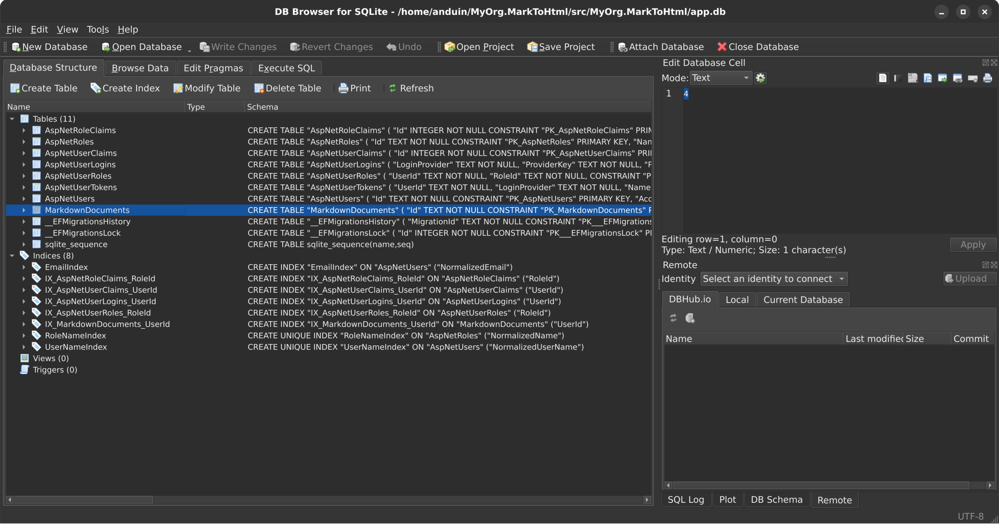

# Aiursoft Template Tutorial - Step 4 - Add a New Data Model and Modify the Database Schema



We can extend the previous example to allow users to save their Markdown documents and later re-edit or even share them. To achieve this, we need to add a new data model and modify the database schema.

Before changing the database schema, we first need to understand the database ORM tool used by Aiursoft Template: [Entity Framework Core (EF Core)](https://learn.microsoft.com/en-us/ef/core/).


**Before you edit:** stop the server with **Ctrl+C**.

```bash
cd ~/Source/MyOrg.MarkToHtml
```

This returns to the repository root. All `src/` paths below start here.

**Our goal:** add the document table without losing the generated identity and settings tables.

## Step 4.1 Understand Entity Framework Core (Optional)

If you are very familiar with Entity Framework Core, you can skip this step.

!!! abstract "What is Entity Framework Core?"

    Entity Framework Core (EF Core) is a powerful object-relational mapping (ORM) tool that allows you to work with databases using .NET objects without having to write SQL statements directly. It supports multiple databases, including SQLite, MySQL, SQL Server, PostgreSQL, and more.

For example, its syntax is similar to:

```csharp
var books = await dbContext.Books
    .Where(b => b.Author == "Anduin Xue")
    .OrderBy(b => b.PublishedDate)
    .Skip(10)
    .Take(10)
    .ToListAsync();
```

This will query the books with the author "Anduin Xue" from the `Books` table, sort them by publication date, skip the first 10 records, take the next 10 records, and convert the result into a list. Its SQL might look like:

```sql
SELECT * FROM Books
WHERE Author = 'Anduin Xue'
ORDER BY PublishedDate
LIMIT 10 OFFSET 10;
```

However, considering that we might modify the structure of some entity classes—such as adding new properties, removing old ones, or changing property types—it is necessary to keep the database structure synchronized with the entity classes.

To achieve this, we need to use EF Core's migration (Migration) feature.

In this example, we will create a new table called `MarkdownDocuments` to store users' markdown documents.

However, this table does not currently exist in the real database.

Therefore, we need to create a migration to instruct EF Core how to create this table.

A migration contains information about changes to the database schema.

When the application starts, it automatically compares the version of the database table structure with the latest migration version and runs any necessary migrations automatically.

This ensures that the database structure remains synchronized with the entity classes.

!!! warning "Do not forget to create a migration after modifying entity classes!"

    If you forget to create a migration or if the migration fails to run, the application will still run, but the executed SQL may not correctly perform the intended operations in the database, potentially leading to runtime exceptions. Therefore, you should always create a new migration whenever you modify an entity class.

## Step 4.2 Create a New Data Model

Create `src/MyOrg.MarkToHtml.Entities/MarkdownDocument.cs`:

```csharp
using System.ComponentModel.DataAnnotations;
using System.ComponentModel.DataAnnotations.Schema;

namespace MyOrg.MarkToHtml.Entities;

public class MarkdownDocument
{
    [Key]
    public Guid Id { get; set; }

    [MaxLength(100)]
    public string? Title { get; set; }

    [MaxLength(65535)]
    public string? Content { get; set; }

    public DateTime CreationTime { get; init; } = DateTime.UtcNow;

    [StringLength(64)]
    public required string UserId { get; set; }

    [ForeignKey(nameof(UserId))]
    public User? User { get; set; }
}
```

In the existing `User.cs`, keep all generated properties and the default avatar logical path (`avatar/default-avatar.jpg`). Add these imports:

```csharp
using System.ComponentModel.DataAnnotations.Schema;
using Newtonsoft.Json;
```
Find `public class User : IdentityUser`. Insert this navigation property **inside that class**, just before its final closing brace:

```csharp
[JsonIgnore]
[InverseProperty(nameof(MarkdownDocument.User))]
public IEnumerable<MarkdownDocument> CreatedDocuments { get; set; } = new List<MarkdownDocument>();
```

`UserId` and `User` establish ownership. `JsonIgnore` prevents serializing the inverse document collection; nullable-analysis attributes are not serialization rules.

Open `src/MyOrg.MarkToHtml.Entities/MarkToHtmlDbContext.cs`.
Find the `GlobalSettings` DbSet inside `TemplateDbContext`.
Insert this **additional** DbSet after it, before the class closes:

```csharp
public DbSet<MarkdownDocument> MarkdownDocuments => Set<MarkdownDocument>();
```

Your DbSet area should now contain both entries:

```csharp
public DbSet<GlobalSetting> GlobalSettings => Set<GlobalSetting>();
public DbSet<MarkdownDocument> MarkdownDocuments => Set<MarkdownDocument>();
```

This is a comparison snippet, not the whole context file. Keep its constructor and methods.

The file name is `MarkToHtmlDbContext.cs`, but its generated class is still `TemplateDbContext`. Preserve its existing `GlobalSettings` DbSet, identity mappings and migration methods; add the new DbSet inside the existing class.

### Code checkpoint - keep the generated members

Pause here and compare the two files before generating a migration.
These are the current generated files with our additions.
If a newer template has extra members, retain them too.

User.cs keeps the existing avatar path and identity fields:

```csharp title="src/MyOrg.MarkToHtml.Entities/User.cs"
using System.ComponentModel.DataAnnotations.Schema;
using Newtonsoft.Json;

using System.ComponentModel.DataAnnotations;
using System.Diagnostics.CodeAnalysis;
using Microsoft.AspNetCore.Identity;

namespace MyOrg.MarkToHtml.Entities;

[ExcludeFromCodeCoverage]
public class User : IdentityUser
{
    public const string DefaultAvatarPath = "avatar/default-avatar.jpg";

    [MaxLength(30)]
    [MinLength(2)]
    public required string DisplayName { get; set; }

    [MaxLength(150)][MinLength(2)] public string AvatarRelativePath { get; set; } = DefaultAvatarPath;

    public DateTime CreationTime { get; init; } = DateTime.UtcNow;
    [JsonIgnore]
    [InverseProperty(nameof(MarkdownDocument.User))]
    public IEnumerable<MarkdownDocument> CreatedDocuments { get; set; } = new List<MarkdownDocument>();

}
```

MarkToHtmlDbContext.cs keeps GlobalSettings and its migration methods:

```csharp title="src/MyOrg.MarkToHtml.Entities/MarkToHtmlDbContext.cs"
using System.Diagnostics.CodeAnalysis;
using Aiursoft.DbTools;
using Microsoft.AspNetCore.Identity.EntityFrameworkCore;
using Microsoft.EntityFrameworkCore;

namespace MyOrg.MarkToHtml.Entities;

[ExcludeFromCodeCoverage]

public abstract class TemplateDbContext(DbContextOptions options) : IdentityDbContext<User>(options), ICanMigrate
{
    public DbSet<GlobalSetting> GlobalSettings => Set<GlobalSetting>();

    public virtual Task MigrateAsync(CancellationToken cancellationToken) =>
        Database.MigrateAsync(cancellationToken);

    public virtual Task<bool> CanConnectAsync() =>
        Database.CanConnectAsync();
    public DbSet<MarkdownDocument> MarkdownDocuments => Set<MarkdownDocument>();


}
```

Your file should have one User class and one TemplateDbContext class, not a second copy pasted below them.
Our separate MarkdownDocument.cs contains the new entity.

## Step 4.3 Create Migration and Update Database

Aiursoft Template supports multiple databases, including SQLite, MySQL, InMemory, and more.

Users can also extend support to other databases, such as `PostgreSQL`, `SQL Server`, etc.

Here, we will create migrations only for the default SQLite and MySQL.

The InMemory database does not require migrations because it is temporary and recreated every time the application starts.

!!! tip "Migration is a noun; it does not mean immediate database changes"

    A Migration is a noun that represents changes to the database schema. We create a migration to inform EF Core how to alter the database structure. When the application starts, it automatically compares the version of the database schema with the latest migration version and runs any missing migrations automatically. This ensures the database schema stays synchronized with the entity classes.

We installed the EF tool in Step 1. Let's check that this terminal can still find it:

```bash
dotnet ef --version
```

This checks the migration tool. **Expected:** version 10.x.
If it is missing, repeat Step 1's PATH setup before reinstalling anything.

### Step 4.3.1 Create Migration for SQLite

Next, we need to create migrations for both SQLite and MySQL.

When creating a migration for SQLite, ensure that `ConnectionStrings.DbType` in `./src/MyOrg.MarkToHtml/appsettings.json` is set to `Sqlite`, and that `DefaultConnection` points to a SQLite database file, for example:

Change **only the existing ConnectionStrings object** to match this comparison.
Keep Storage, AppSettings, logging, and every other section in the file.

```json
"ConnectionStrings": {
    "AllowCache": "True",
    "DbType": "Sqlite",
    "DefaultConnection": "DataSource=app.db;Cache=Shared"
},
```

Then, run the following command to create the migration:

```bash
cd src/MyOrg.MarkToHtml.Sqlite
```

This moves from the repository root into the Sqlite migration project.

```bash
dotnet ef migrations add AddMarkdownDocumentsTable --context "SqliteContext" -s ../MyOrg.MarkToHtml/MyOrg.MarkToHtml.csproj
```

This generates the migration. `--context` selects SqliteContext.
`-s` points to the web project that loads the application's settings.
**Expected:** `Done`, with a new migration file in this provider's Migrations folder.
It does not apply the schema change yet.

```bash
cd ../..
```

This moves up twice, returning to the repository root.

!!! note "The above command will not change any database schema!"

    This command only creates a migration file that tells EF Core how to create the `MarkdownDocuments` table. It does not actually change the database schema. To actually apply the migration, the application will automatically apply all pending migrations when it starts.

You will notice output similar to:

```text
Done. To undo this action, use 'ef migrations remove'
```

At the same time, a new migration file will be generated under the `./src/MyOrg.MarkToHtml.Sqlite/Migrations/` directory, named something like `20231010123456_AddMarkdownDocumentsTable.cs`. Its content might look like:

```csharp
using System;
using Microsoft.EntityFrameworkCore.Migrations;

#nullable disable

namespace MyOrg.MarkToHtml.Sqlite.Migrations
{
    /// <inheritdoc />
    public partial class AddMarkdownDocumentsTable : Migration
    {
        /// <inheritdoc />
        protected override void Up(MigrationBuilder migrationBuilder)
        {
            migrationBuilder.CreateTable(
                name: "MarkdownDocuments",
                columns: table => new
                {
                    Id = table.Column<Guid>(type: "TEXT", nullable: false),
                    Title = table.Column<string>(type: "TEXT", maxLength: 100, nullable: true),
                    Content = table.Column<string>(type: "TEXT", maxLength: 65535, nullable: true),
                    CreationTime = table.Column<DateTime>(type: "TEXT", nullable: false),
                    UserId = table.Column<string>(type: "TEXT", maxLength: 64, nullable: false)
                },
                constraints: table =>
                {
                    table.PrimaryKey("PK_MarkdownDocuments", x => x.Id);
                    table.ForeignKey(
                        name: "FK_MarkdownDocuments_AspNetUsers_UserId",
                        column: x => x.UserId,
                        principalTable: "AspNetUsers",
                        principalColumn: "Id",
                        onDelete: ReferentialAction.Cascade);
                });

            migrationBuilder.CreateIndex(
                name: "IX_MarkdownDocuments_UserId",
                table: "MarkdownDocuments",
                column: "UserId");
        }

        /// <inheritdoc />
        protected override void Down(MigrationBuilder migrationBuilder)
        {
            migrationBuilder.DropTable(
                name: "MarkdownDocuments");
        }
    }
}
```

We need to carefully Review the changes above.

When this new migration runs, it will create a new table `MarkdownDocuments` and include all columns and constraints defined in our data model, including the foreign key constraints we defined.

The `onDelete: ReferentialAction.Cascade` indicates that when a user is deleted, the associated documents will be automatically deleted as well.

This is in line with our expectations.

!!! danger "Be sure to carefully Review the migration file to ensure it meets expectations"

    Migration files are auto-generated, but they may not always align with our expectations. For example, sometimes we rename a column, but EF Core might treat it as a new column, discarding the old column's data and creating a new empty column. This can be catastrophic for a production system.

    Therefore, after creating each migration, we should carefully Review the generated migration file to ensure it meets our expectations. If any issues are found, we can manually modify the model file or the migration file, or delete the migration and recreate it.

The `Down` method is used to roll back the migration, which means dropping the `MarkdownDocuments` table. This is as expected, so we can proceed.

### Step 4.3.2 Create Migration for MySQL

Next, we need to create a migration for MySQL.

When creating a migration for MySQL, ensure that `./src/MyOrg.MarkToHtml/appsettings.json` has `ConnectionStrings.DbType` set to `MySQL`, and that `DefaultConnection` points to a MySQL database.

The file can be modified to start like this:

Change **only the existing ConnectionStrings object** to match this comparison.
Keep Storage, AppSettings, logging, and every other section in the file.

```json
"ConnectionStrings": {
    "AllowCache": "True",
    "DbType": "MySql",
    "DefaultConnection": "Server=localhost;Database=template;Uid=template;Pwd=template_password;"
},
```

The settings belong to the web project, not the MySql class library. Start from the repository root. Choose an unused local port if 3306 is occupied and use the same port in the connection string.

Next, to create a migration, we must start a real MySQL. We can use Docker to quickly start a MySQL instance:

```bash
sudo docker run -d --name tutorial-mysql \
  -e MYSQL_RANDOM_ROOT_PASSWORD=true \
  -e MYSQL_DATABASE=template \
  -e MYSQL_USER=template \
  -e MYSQL_PASSWORD=template_password \
  -p 127.0.0.1:3306:3306 \
  mysql:9.7.0
```

Copy the whole block as one command. A backslash joins the following line.

- `-d` runs the database in the background.
- `--name tutorial-mysql` names this disposable container.
- `MYSQL_RANDOM_ROOT_PASSWORD` keeps us from using an example root password.
- `MYSQL_DATABASE` creates the `template` database.
- `MYSQL_USER` and `MYSQL_PASSWORD` create our tutorial application's database account.
- `-p 127.0.0.1:3306:3306` exposes it only on this machine, at the port in our connection string.
- `mysql:9.7.0` selects the database image.

**Expected:** Docker prints a container ID. The database is not ready instantly.
If Docker says it cannot connect to its service, finish the Docker setup from Step 1.
If port 3306 is occupied, use an unused local port and add `Port=<your-port>;` to DefaultConnection.
Do not stop another application's database.

!!! info "Creating a migration requires a connection to the database"

    Although creating a migration does not alter the database schema, it requires a connection to the database so that EF Core can read the database's metadata and generate the correct migration code. Therefore, ensure your MySQL instance is running and that the connection string is accurate.

Wait until a query using the application database user succeeds:

```bash
sudo docker exec tutorial-mysql sh -c 'MYSQL_PWD="$MYSQL_PASSWORD" mysql -u "$MYSQL_USER" "$MYSQL_DATABASE" -e "SELECT 1"'
```

`docker exec` runs a command inside the named container.
The small shell command uses that container's configured application username and password.
`SELECT 1` is a harmless readiness query.

**Expected:** a column containing `1` and no connection error.
If it fails while MySQL is starting, wait a few seconds and run that same check again.
Do not print the random root password or change the app to use root.

This meets our application's connection string requirements. At this point, we can use the following command to create a migration:

```bash
cd src/MyOrg.MarkToHtml.MySql
```

This moves from the repository root into the MySql migration project.

```bash
dotnet ef migrations add AddMarkdownDocumentsTable --context "MySqlContext" -s ../MyOrg.MarkToHtml/MyOrg.MarkToHtml.csproj
```

This generates the migration. `--context` selects MySqlContext.
`-s` points to the web project that loads the application's settings.
**Expected:** `Done`, with a new migration file in this provider's Migrations folder.
It does not apply the schema change yet.

```bash
cd ../..
```

This moves up twice, returning to the repository root.

Similarly, a new migration file will be generated under the `./src/MyOrg.MarkToHtml.MySql/Migrations/` directory, named something like `20231010123456_AddMarkdownDocumentsTable.cs`.

Carefully review its content to ensure it meets your expectations, then proceed.

### Step 4.3.3 Return to SQLite for the next chapter

Note: If you encounter errors when creating the migration, such as being unable to connect to the database or missing certain types, it may be because your MySQL server is not running properly, or you forgot to update the connection string in the `appsettings.json` file.

Make sure your MySQL server is running and the connection string is correct.

For the main tutorial path, switch back to SQLite below.
If you deliberately stay on MySQL, leave its container running. Do not stop the database your app still uses.

Note: After creating the MySQL migration, if you no longer need this MySQL instance, you can stop and remove it using the following command:

```bash
sudo docker stop tutorial-mysql
```

This stops only our named, disposable tutorial database.

```bash
sudo docker rm -v tutorial-mysql
```

This removes that container and its anonymous data volume.
It deletes the temporary MySQL data, not the migration source files we generated.
Only use it on this disposable container.

**Before starting the app again**, revert the `ConnectionStrings.DbType` setting in the `appsettings.json` file back to `Sqlite`, and set `DefaultConnection` to point to a SQLite database file, for example:

Change **only the existing ConnectionStrings object** to match this comparison.
Keep Storage, AppSettings, logging, and every other section in the file.

```json
"ConnectionStrings": {
    "AllowCache": "True",
    "DbType": "Sqlite",
    "DefaultConnection": "DataSource=app.db;Cache=Shared"
},
```

Every time you modify any entity class, you should repeat the steps in 4.3.1 and 4.3.2 to create new migrations. If you support additional databases, you should also create migrations for them.

!!! warning "After resetting the database or deleting users from the database, you must log out all currently logged-in users!"

    If you reset the database or delete users from the database, be sure to log out the currently logged-in user. Aiursoft Template's authentication issues a signed Token in the Cookie. If a user is deleted—such as when switching databases or resetting the database—the Token remains valid, but the user no longer exists. In this case, the user needs to log in again to obtain a new Token. Otherwise, exceptions will occur when accessing data.

    Do not delete shared data-protection keys. For a disposable experiment, use a fresh isolated database and sign out before switching databases. Applications that share a user profile can also share the key directories below:

    * Local debugging: `~/.aspnet/DataProtection-Keys` directory
    * Docker environment: `/data/aspnet/DataProtection-Keys` directory

## Step 4.4 Run the application and verify database auto-migration (optional)

!!! tip "This step is optional"

    This step is optional. In production environments, migrations run automatically when the application starts.

Now that we have created the migrations, we need to run the application so it can automatically apply these migrations and update the database schema.

Before proceeding, you can first read the `./src/MyOrg.MarkToHtml/Startup.cs` file to understand how the application is configured to use the database. Locate the following code and do not modify it:

```csharp
var (connectionString, dbType, allowCache) = configuration.GetDbSettings();
services.AddSwitchableRelationalDatabase(
    dbType: EntryExtends.IsInUnitTests() ? "InMemory": dbType,
    connectionString: connectionString,
    supportedDbs:
    [
        new MySqlSupportedDb(allowCache: allowCache, splitQuery: false),
        new SqliteSupportedDb(allowCache: allowCache, splitQuery: true),
        new InMemorySupportedDb()
    ]);
```

The code above is the core code for configuring the database support for this application.

It selects which database to use based on the `ConnectionStrings.DbType` in the configuration file, and connects to the database using the `ConnectionStrings.DefaultConnection`.

The `allowCache` setting indicates whether to allow caching the query results of the database in memory to improve performance.

For a single instance, this value should typically be set to `True` to achieve significant performance improvements.

However, for deployments with multiple instances, this value should be set to `False` to avoid issues with cache inconsistency.

We also notice that in the unit test environment, the database type is forcibly set to `InMemory` to avoid dependencies on a real database.

Next, we directly run the application using the command line:

```bash
dotnet run --project ./src/MyOrg.MarkToHtml/MyOrg.MarkToHtml.csproj
```

During this run, you will notice the following output (note: it only appears on the first run):

```text
info: Microsoft.EntityFrameworkCore.Database.Command[20101]
      Executed DbCommand (1ms) [Parameters=[], CommandType='Text', CommandTimeout='30']
      SELECT "MigrationId", "ProductVersion"
      FROM "__EFMigrationsHistory"
      ORDER BY "MigrationId";
info: Microsoft.EntityFrameworkCore.Migrations[20402]
      Applying migration '20250924144553_AddMarkdownDocumentsTable'.
info: Microsoft.EntityFrameworkCore.Database.Command[20101]
      Executed DbCommand (0ms) [Parameters=[], CommandType='Text', CommandTimeout='30']
      CREATE TABLE "MarkdownDocuments" (
          "Id" TEXT NOT NULL CONSTRAINT "PK_MarkdownDocuments" PRIMARY KEY,
          "Title" TEXT NULL,
          "Content" TEXT NULL,
          "CreationTime" TEXT NOT NULL,
          "UserId" TEXT NOT NULL,
          CONSTRAINT "FK_MarkdownDocuments_AspNetUsers_UserId" FOREIGN KEY ("UserId") REFERENCES "AspNetUsers" ("Id") ON DELETE CASCADE
      );
info: Microsoft.EntityFrameworkCore.Database.Command[20101]
      Executed DbCommand (0ms) [Parameters=[], CommandType='Text', CommandTimeout='30']
      CREATE INDEX "IX_MarkdownDocuments_UserId" ON "MarkdownDocuments" ("UserId");
info: Microsoft.EntityFrameworkCore.Database.Command[20101]
      Executed DbCommand (0ms) [Parameters=[], CommandType='Text', CommandTimeout='30']
      INSERT INTO "__EFMigrationsHistory" ("MigrationId", "ProductVersion")
      VALUES ('20250924144553_AddMarkdownDocumentsTable', '9.0.9');
info: Microsoft.EntityFrameworkCore.Database.Command[20101]
      Executed DbCommand (5ms) [Parameters=[], CommandType='Text', CommandTimeout='30']
      DELETE FROM "__EFMigrationsLock";
info: MyOrg.MarkToHtml.Entities.TemplateDbContext[0]
      Migrated database associated with context TemplateDbContext
```

As you can see, the application automatically detected that the database schema is inconsistent with the latest migration version, so it automatically applied the migration we just created, creating the `MarkdownDocuments` table.

It will start directly on subsequent runs without reapplying the migration.


## Checkpoint 4 - The new table exists

Save the files in your editor first. Let's check this small piece before going on.

```bash
dotnet build ./MyOrg.MarkToHtml.sln
```

This compiles the solution. **Expected:** `Build succeeded.` with no errors.
If it fails, stop here and check the first error's file and line number.

```bash
dotnet run --project ./src/MyOrg.MarkToHtml/MyOrg.MarkToHtml.csproj
```

This starts the app with the changes you just made.
Open the listening address in your browser.

- Confirm `ConnectionStrings:DbType` is back to `Sqlite`.
- Look for the new migration under the Sqlite project and another under MySql.
- On the first app startup after the migration, look for `AddMarkdownDocumentsTable` in the migration log.
- In a SQLite browser, open `src/MyOrg.MarkToHtml/app.db` and find `MarkdownDocuments`.
- Existing login and settings tables should still exist.

A migration file records a schema change. Starting the app applies the selected provider's pending migrations.
Creating the file and applying it are two separate checkpoints.

Finished checking? Press **Ctrl+C** and wait for the terminal prompt.
You have a working stopping point now.

Continue with [Step 5](./step5.md).
