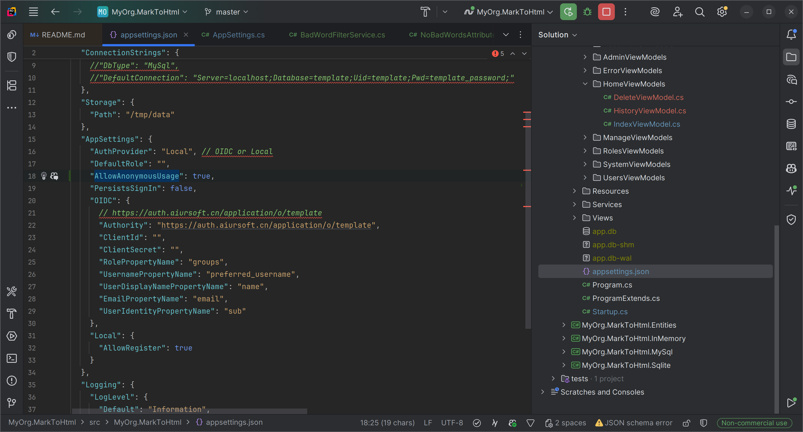

# Aiursoft Template Tutorial - Step 7 - Add a New Configuration Item and Support Environment Variables



As a site administrator, there may be some application configurations that the default settings cannot meet.

We need to allow administrators to adjust certain configuration items themselves to change the application's default behavior, for example:

* Allow or disallow new user registration.
* Allow or disallow anonymous users from using the application.
* Allow or disallow users from deleting their own content.


**Before you edit:** stop the server with **Ctrl+C**.

```bash
cd ~/Source/MyOrg.MarkToHtml
```

This returns to the repository root. All `src/` paths below start here.

**Our goal:** change one setting at a time and see exactly which behavior it controls.

## Step 7.1 - Understand the ASP.NET Core Configuration System (Optional)

Aiursoft Template uses the built-in configuration system of ASP.NET Core. The configuration system allows us to load configuration data from multiple sources, such as:

* appsettings.json file
* appsettings.{Environment}.json file, which means appsettings.Development.json in the development environment and appsettings.Production.json in the production environment.
* Environment variables
* Command-line arguments

Typically, we use the `appsettings.json` file for local development configuration.

The image keeps its settings file in the persistent data volume.
For deployment, prefer declared environment overrides in the reviewed configuration.
Do not rely on manually editing a running container.

For this exercise, restart the app after each setting change.
Configuration providers can reload files, but not every startup-bound setting is reread by every service.
A restart gives us a clear, repeatable checkpoint.

Real API tokens and OIDC client secrets belong in protected secret configuration, outside Git.
The disposable MySQL password in Step 4 is only a public learning example.

For example, we can now try to disable new-account registration while leaving login available of the application.

First, use the first method: open the `./src/MyOrg.MarkToHtml/appsettings.json` file and set its `AppSettings:Local:AllowRegister` field to `false`.

Find the existing AllowRegister property **inside AppSettings, then Local**.
Change its value from true to false:

```json
"AllowRegister": false
```

This is one property to edit, not a complete replacement appsettings.json.
Keep the other settings, including the storage configuration.

Save the file, then start the application:

```bash
dotnet run --project ./src/MyOrg.MarkToHtml/MyOrg.MarkToHtml.csproj
```

This starts the app using the changed file setting.
**Expected:** the Register button disappears, while the existing account can still log in.

Press **Ctrl+C** after checking.
Set AllowRegister back to true in the file before the next experiment.

Similarly, we can use environment variables to override configurations in the configuration file.

This time, we roll back the configuration in the `appsettings.json` file.

Considering that environment variables have higher priority, we can directly set the environment variable `AppSettings__Local__AllowRegister` to `false` to disable the registration feature.

!!! note "Environment variables override the JSON settings here"

    With the default application configuration used here, environment variables override appsettings.json. Explicit command-line configuration can take precedence over environment variables. Therefore, we can use environment variables to override configurations in configuration files.

    In the example above, even if we set `AppSettings:Local:AllowRegister` to `true` in the `appsettings.json` file, as long as we set the environment variable `AppSettings__Local__AllowRegister` to `false`, the registration feature will still be disabled.

    Therefore, in production environments, especially when deploying with Docker, we recommend using environment variables to configure the application instead of directly modifying configuration files.

With the server stopped and the terminal in the repository root, run this single command:

```bash
AppSettings__Local__AllowRegister=false dotnet run --project ./src/MyOrg.MarkToHtml/MyOrg.MarkToHtml.csproj
```

The assignment at the start sets one environment variable for this run only.
The rest starts the same web project as before.
**Expected:** registration is disabled even though the file says true.
Press **Ctrl+C** after checking; do not leave this server running while editing the next part.

!!! tip "Note the naming convention for environment variables"

    Use double underscores `__` in environment variables to represent the hierarchy of configuration items. For example, `AppSettings:Local:AllowRegister` is represented as `AppSettings__Local__AllowRegister` in environment variables.

You will also notice that the register button has disappeared.

For deployment, declare non-secret configuration in the reviewed deployment file. Keep actual secret values out of version control.

## Step 7.2 - Add a New Configuration Item

In the previous example, we demonstrated a configuration item `AppSettings:Local:AllowRegister` that is already supported by the application. But what if we need to add a completely new configuration item?

Below, we will use `AppSettings:AllowAnonymousUsage` as an example to demonstrate how to add a new configuration item and use it in the code.

First, edit the `AppSettings` section in the `appsettings.json` file, and add a new configuration item `AllowAnonymousUsage`, setting its default value to `true`:

```json
"AllowAnonymousUsage": true,
```

This is **one property to insert**, not a complete JSON file.
Find `"AuthProvider": "Local",` inside the existing AppSettings section and add this line beneath it.
Keep the rest of appsettings.json, including the Local and OIDC objects.


Next, we edit the `./src/MyOrg.MarkToHtml/Configuration/AppSettings.cs` file and add a new property `AllowAnonymousUsage`:

```csharp
public bool AllowAnonymousUsage { get; init; } = true;
```

Preserve the existing AppSettings properties and add only AllowAnonymousUsage.

Now open `Controllers/HomeController.cs`.
Add these two missing imports at the top, alongside the existing using statements:

```csharp
using Microsoft.Extensions.Options;
using MyOrg.MarkToHtml.Configuration;
```

`IOptions<AppSettings>` comes from the first namespace; our AppSettings class comes from the second.
Without them, the new constructor does not compile.

Next, we can use this new configuration option in the code.

The purpose of this configuration option is to disable anonymous usage. We directly go to the `./src/MyOrg.MarkToHtml/Controllers/HomeController.cs` file and first request `IOptions<AppSettings>` from dependency injection:

```csharp
public class HomeController(
    IOptions<AppSettings> appSettings,
    ILogger<HomeController> logger,
    UserManager<User> userManager,
    TemplateDbContext context,
    MarkToHtmlService mtohService) : Controller
```

Then, in the `Index` method, check this configuration. If the application disables anonymous access and the current user is not logged in, directly return `Challenge()` to force the user to log in:

!!! tip "What is the `Challenge()` method?"

    The `Challenge()` method triggers the authentication middleware, which typically redirects the user to the login page. If you're using OIDC authentication, it redirects the user to the OIDC provider's login page.

    Returning `Challenge()` is far more generic and reliable than `return RedirectToAction("Login", "Account")`. Especially when considering that the application might support multiple authentication methods, such as OIDC, Local, etc.

```csharp
    public IActionResult Index()
    {
        if (!User.Identity!.IsAuthenticated && !appSettings.Value.AllowAnonymousUsage)
        {
            logger.LogWarning("Anonymous user trying to access the home page. But it is not allowed.");
            return Challenge();
        }
        return this.StackView(new IndexViewModel());
    }
```

Similarly, the POST method of `Index` also needs to check this configuration item. Preserve the existing controller and add the anonymous-access check:

In the existing Index POST action, add this at the start of its anonymous `else` branch, before conversion:

```csharp
if (!appSettings.Value.AllowAnonymousUsage)
{
    return Challenge();
}
```

Keep the authenticated save branch, validation, Edit, History and Delete actions from Step 5. Do not replace existing methods with omitted-code placeholders.

Edit, History, and Delete still have `[Authorize]`. Keep them; the complete checkpoint below shows the whole controller.

### Code checkpoint - compare the finished files

If you are unsure where the pieces went, pause here.
These are the complete files after this chapter, with the methods from Step 5 still present.

Compare your AppSettings.cs first:

```csharp title="Configuration/AppSettings.cs"
namespace MyOrg.MarkToHtml.Configuration;

public class AppSettings
{
    public required string AuthProvider { get; init; } = "Local";
    public bool LocalEnabled => AuthProvider == "Local";
    public bool OIDCEnabled => AuthProvider == "OIDC";

    public required OidcSettings OIDC { get; init; }
    public required LocalSettings Local { get; init; }

    /// <summary>
    /// Keep the user sign in after the browser is closed.
    /// </summary>
    public bool PersistsSignIn { get; init; }

    /// <summary>
    /// Automatically assign the user to this role when they log in.
    /// </summary>
    public string? DefaultRole { get; init; } = string.Empty;
    public bool AllowAnonymousUsage { get; init; } = true;

}
```

Then compare HomeController.cs. There should be one GET Index action and one POST Index action.
The remaining actions still protect the signed-in user's own notes.

```csharp title="Controllers/HomeController.cs"
using Microsoft.Extensions.Options;
using MyOrg.MarkToHtml.Configuration;
using System.ComponentModel.DataAnnotations;
using Aiursoft.CSTools.Tools;
using MyOrg.MarkToHtml.Models.HomeViewModels;
using MyOrg.MarkToHtml.Services;
using Aiursoft.UiStack.Navigation;
using Microsoft.AspNetCore.Authorization;
using Microsoft.AspNetCore.Identity;
using Microsoft.AspNetCore.Mvc;
using Microsoft.EntityFrameworkCore;
using MyOrg.MarkToHtml.Entities;


namespace MyOrg.MarkToHtml.Controllers;

public class HomeController(
    IOptions<AppSettings> appSettings,
    ILogger<HomeController> logger,
    UserManager<User> userManager,
    TemplateDbContext context,
    MarkToHtmlService mtohService) : Controller
{
    [RenderInNavBar(
        NavGroupName = "Features",
        NavGroupOrder = 1,
        CascadedLinksGroupName = "Home",
        CascadedLinksIcon = "home",
        CascadedLinksOrder = 1,
        LinkText = "Convert Document",
        LinkOrder = 1)]
    public IActionResult Index()
    {
        if (!User.Identity!.IsAuthenticated && !appSettings.Value.AllowAnonymousUsage)
        {
            logger.LogWarning("Anonymous user trying to access the home page. But it is not allowed.");
            return Challenge();
        }
        return this.StackView(new IndexViewModel());
    }

    [HttpPost]
    [ValidateAntiForgeryToken]
    public async Task<IActionResult> Index(IndexViewModel model)
    {
        if (!ModelState.IsValid)
        {
            return this.StackView(model);
        }

        var userId = userManager.GetUserId(User);
        if (User.Identity?.IsAuthenticated == true && !string.IsNullOrWhiteSpace(userId))
        {
            // If the user is authenticated, this action only saves the document in the database. And it's `edit` action to render it.
            // And go to the edit page.
            logger.LogTrace("Authenticated user submitted a document with ID: '{Id}'. Save it to the database.",
                model.DocumentId);
            var documentInDb = await context.MarkdownDocuments
                .FirstOrDefaultAsync(d => d.Id == model.DocumentId && d.UserId == userId);
            var isExistingDocument = documentInDb != null;
            if (documentInDb != null)
            {
                logger.LogInformation("Updating the document with ID: '{Id}'.", model.DocumentId);
                documentInDb.Content = model.InputMarkdown.SafeSubstring(65535);
                documentInDb.Title = model.Title;
            }
            else
            {
                logger.LogInformation("Creating a new document with ID: '{Id}'.", model.DocumentId);
                model.DocumentId = Guid.NewGuid();
                var newDocument = new MarkdownDocument
                {
                    Id = model.DocumentId,
                    Content = model.InputMarkdown.SafeSubstring(65535),
                    Title = model.InputMarkdown.SafeSubstring(40),
                    UserId = userId
                };
                context.MarkdownDocuments.Add(newDocument);
            }

            await context.SaveChangesAsync();
            return RedirectToAction(nameof(Edit), new { id = model.DocumentId, saved = isExistingDocument });
        }
        else
        {
            if (!appSettings.Value.AllowAnonymousUsage)
            {
                return Challenge();
            }

            // If the user is not authenticated, just show the result.
            logger.LogInformation(
                "An anonymous user submitted a document with ID: '{Id}'. It was not saved to the database.",
                model.DocumentId);
            model.OutputHtml = mtohService.ConvertMarkdownToHtml(model.InputMarkdown);
            return this.StackView(model);
        }
    }

    [Authorize]
    public async Task<IActionResult> Edit([Required][FromRoute] Guid id, [FromQuery] bool? saved = false)
    {
        var userId = userManager.GetUserId(User);
        var document = await context.MarkdownDocuments.FirstOrDefaultAsync(d => d.Id == id && d.UserId == userId);

        if (document == null)
        {
            return NotFound("The document was not found or you do not have permission to edit it.");
        }

        var model = new IndexViewModel
        {
            DocumentId = document.Id,
            Title = document.Title,
            InputMarkdown = document.Content ?? string.Empty,
            OutputHtml = mtohService.ConvertMarkdownToHtml(document.Content ?? string.Empty),
            IsEditing = true,
            SavedSuccessfully = saved ?? false
        };

        return this.StackView(model: model, viewName: nameof(Index)); // Reuse the Index view for editing.
    }

    [Authorize]
    [RenderInNavBar(
        NavGroupName = "Features",
        NavGroupOrder = 1,
        CascadedLinksGroupName = "Home",
        CascadedLinksIcon = "history",
        CascadedLinksOrder = 2,
        LinkText = "My documents",
        LinkOrder = 2)]
    public async Task<IActionResult> History()
    {
        var userId = userManager.GetUserId(User);
        var documents = await context.MarkdownDocuments
            .Where(d => d.UserId == userId)
            .OrderByDescending(d => d.CreationTime)
            .ToListAsync();

        var model = new HistoryViewModel
        {
            MyDocuments = documents
        };
        return this.StackView(model);
    }

    // GET: /Home/Delete/{guid}
    [Authorize]
    public async Task<IActionResult> Delete(Guid? id)
    {
        if (id == null)
        {
            return NotFound();
        }

        var userId = userManager.GetUserId(User);
        var document = await context.MarkdownDocuments
            .FirstOrDefaultAsync(d => d.Id == id && d.UserId == userId);

        if (document == null)
        {
            // Document not found or user does not have permission.
            return NotFound();
        }

        return this.StackView(new DeleteViewModel
        {
            Document = document
        });
    }

    // POST: /Home/Delete/{guid}
    [HttpPost, ActionName("Delete")]
    [ValidateAntiForgeryToken]
    [Authorize]
    public async Task<IActionResult> DeleteConfirmed(Guid id)
    {
        var userId = userManager.GetUserId(User);
        var document = await context.MarkdownDocuments
            .FirstOrDefaultAsync(d => d.Id == id && d.UserId == userId);

        if (document == null)
        {
            return NotFound();
        }

        context.MarkdownDocuments.Remove(document);
        await context.SaveChangesAsync();

        logger.LogInformation("Document with ID: '{Id}' was deleted by user: '{UserId}'.", id, userId);

        return RedirectToAction(nameof(History));
    }

}
```

## Step 7.3 - Test the New Configuration Item

Next, we can test this new configuration item. Use the following command to start the project:

```bash
AppSettings__AllowAnonymousUsage=false dotnet run --project ./src/MyOrg.MarkToHtml/MyOrg.MarkToHtml.csproj
```

This sets the new switch for this process, then starts the web project.
**Expected:** a signed-out visit to Home is redirected to Login.
This is a different switch from AllowRegister.

Then open the browser and visit `http://localhost:5000`. We will notice that if we log out the current user, the home page can no longer be accessed, and the application will automatically redirect to the login page.


## Checkpoint 7 - The two switches do different jobs

Save the files in your editor first. Let's check this small piece before going on.

```bash
dotnet build ./MyOrg.MarkToHtml.sln
```

This compiles the solution. **Expected:** `Build succeeded.` with no errors.
If it fails, stop here and check the first error's file and line number.

```bash
dotnet run --project ./src/MyOrg.MarkToHtml/MyOrg.MarkToHtml.csproj
```

This starts the app with the changes you just made.
Open the listening address in your browser.

- First run normally: sign out and confirm anonymous conversion works.
- Stop the server. Run the `AppSettings__AllowAnonymousUsage=false` command from 7.3.
- In a signed-out browser, opening Home should send you to Login.
- Sign in and confirm saving your own notes still works.
- Stop that server before trying a different setting.

The environment assignment before a command applies to that command.
Starting normally again uses the default from appsettings.json.
AllowRegister controls registration. AllowAnonymousUsage controls unsigned conversion.

Finished checking? Press **Ctrl+C** and wait for the terminal prompt.
You have a working stopping point now.

Continue with [Step 8](./step8.md).
